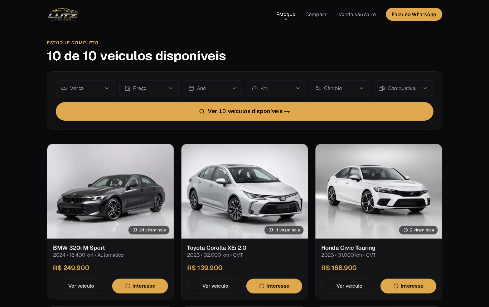

# Lutz Motors

Site para loja de seminovos: estoque com filtros, página de cada carro com fotos e vídeos, comparador, simulador de financiamento e atendimento direto no WhatsApp.

**[Ver no ar](https://lutzmotors.vercel.app)**

> O código é privado. Aqui estão os prints e o link do site no ar.

<table>
  <tr>
    <td></td>
    <td></td>
  </tr>
</table>

## O que o site faz

- Estoque com filtro por marca, preço, ano, quilometragem, câmbio e combustível.
- Página de cada carro com fotos e vídeos.
- Comparador de carros lado a lado.
- Simulador de financiamento.
- "Venda seu carro": o cliente oferece o carro dele para a loja.
- Botão de WhatsApp em todas as páginas e barra fixa de atendimento no celular.

## Tecnologia

Next.js, React e TypeScript, com animações em Framer Motion e elementos 3D em Three.js. Hospedado na Vercel.

## Quer um site assim?

[WhatsApp (51) 99832-8628](https://wa.me/5551998328628) · [victorconceicao682@gmail.com](mailto:victorconceicao682@gmail.com) · [Mais projetos](https://github.com/VictorNlc)
